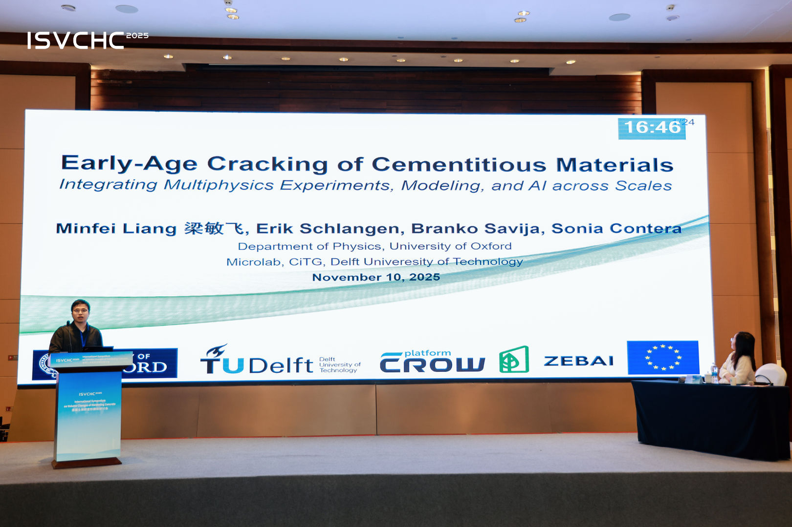
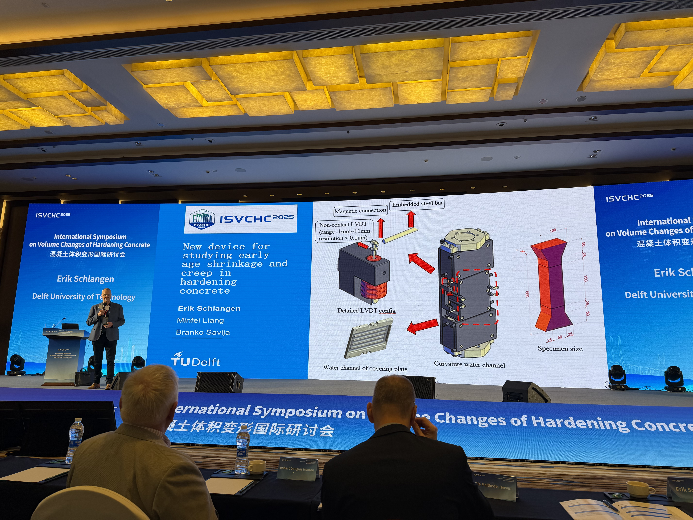
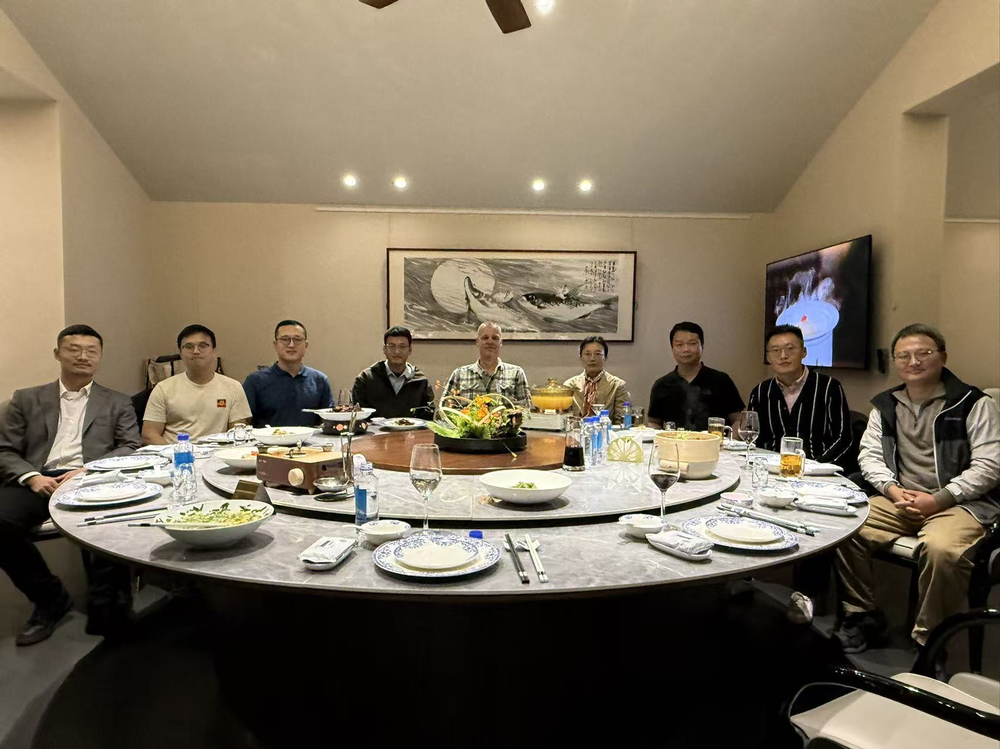

Early in November, I returned to China and visited Southeast University in Nanjing for the ISVCHC 2025 conference. It was a great chance to reconnect with many old friends.

I presented my latest work on Mini-TSTM, multiphysical modelling, and AI for early-age cracking. My PhD supervisor Erik also showcased this research in his talk—always a proud moment.

The best part? Meeting many friends from the Microlab again. The energy, the conversations, the memories—it felt like coming home.

Many thanks to Prof. Sonia Contera and the EU ZEBAI project for supporting my trip.

---